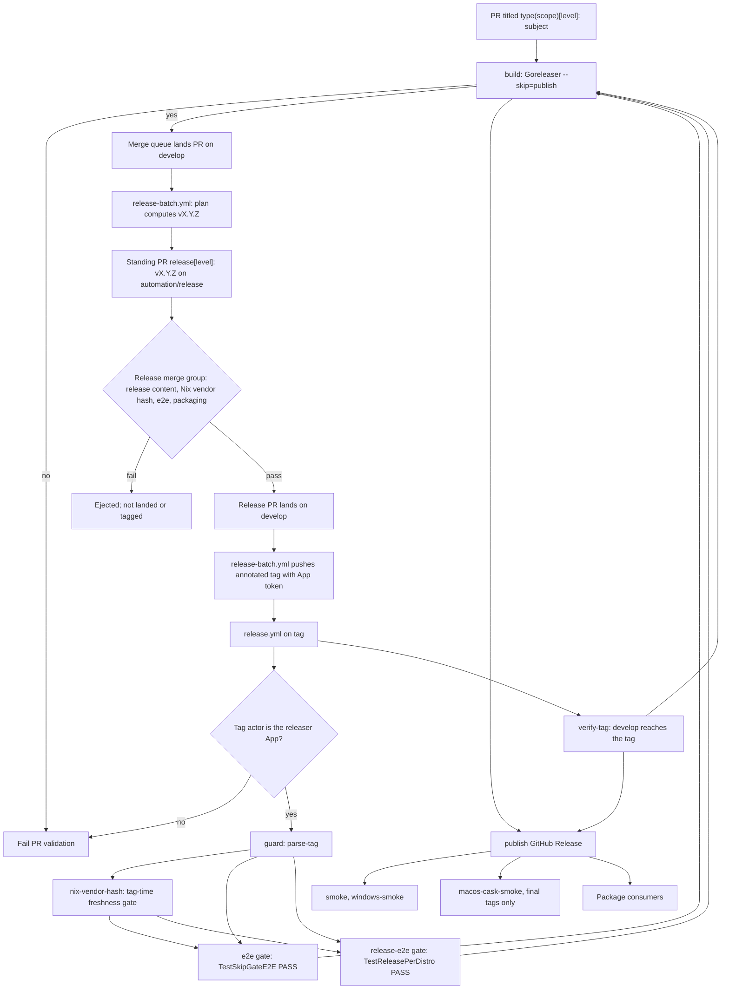
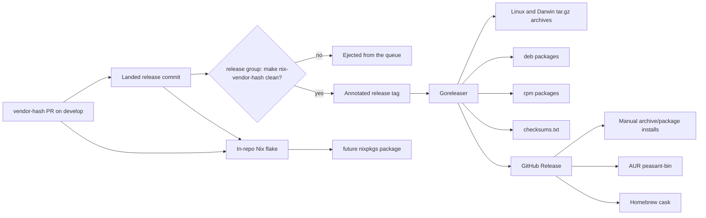
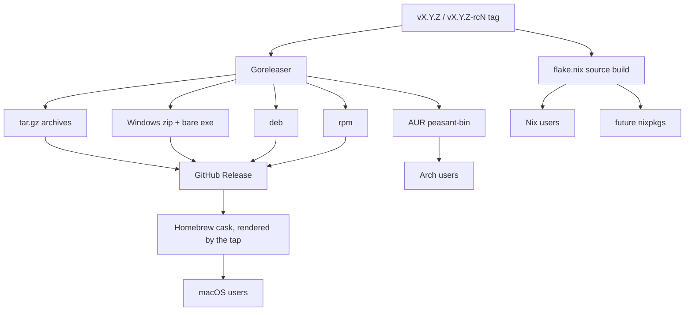

# Peasant Release Architecture

This document is the maintainer-facing reference for the release system: which
workflow owns which invariant, how release data moves from source commits into
packages, and why tags are created only after Nix hash freshness has been proven.
For operator steps, use the [release runbook](release-runbook.md).

## Overview

Peasant has one canonical release producer: an annotated `vX.Y.Z` or
`vX.Y.Z-rcN` tag. That tag drives one GitHub Release through Goreleaser. Archives,
checksums, `.deb`, `.rpm`, AUR, Homebrew, and Nix are consumers of that frozen
source state.

The split is intentional:

- `title-guard.yml` owns release intent: every PR title must pass
  `release-intent check-title`, and the release PR's content must match the
  generator.
- `release-batch.yml` owns the version and the tag: it computes the version from
  the landed titles, keeps the standing release PR current, and tags the landed
  release commit with the releaser App. A required independent approval remains
  deferred for the single-maintainer repository.
- `release.yml` owns immutable tag publication: final-vs-rc lineage, tag-time Nix
  hash freshness, the **`e2e` + `release-e2e` publication gates** (both must pass
  before Goreleaser runs), the Goreleaser build, GitHub Release publication, and
  post-publish smoke.
- `e2e.yml` / `release-e2e.yml` are reusable workflows `release.yml` calls on
  **every** release tag (rc and final): `e2e.yml` proves the full-stack push
  skip-gate (`TestSkipGateE2E`) and `release-e2e.yml` proves installed per-distro
  packages (`TestReleasePerDistro`). Each must emit a positive `--- PASS` line; a
  SKIP or "no tests to run" **fails** the gate — no asserted coverage ⇒ no publish.
- `release-validate.yml` owns package installability in the release PR's merge
  group, before a tag is minted, and again on rc tags.
- `nix-vendor-hash.yml` keeps `develop` close to release-ready after dependency
  and package-input changes, through an `automation/vendor-hash` PR.



## Trigger Model

Release intent is expressed only by PR titles, `type(scope)[level]: subject`
([runbook](release-runbook.md#current-release-procedure)). No author writes a
version: `release-intent plan`, built from the pinned `peasant-labs/infra`
commit, computes it from the titles landed since the last final tag, and the
bot titles its standing release PR `release[level]: vX.Y.Z`. The release config
is `.github/release-intent.yaml` and the queue policy is
`.github/release-queue.policy.yml`; `release-intent check-workflows` (`make
check-workflows`) keeps the workflows matching that policy. The only piece left
in `github.com/peasant-labs/schema/cmd/release-guard` is `parse-tag`, which
`release.yml` runs. Schema releases occur in the standalone schema repository
and cannot trigger Peasant's workflow.

No workflow checks a PR author's permission: the App writes the release PR and
the tag, and the merge queue lands them. A required approval is deferred because
GitHub does not permit self-approval and there is one active maintainer.

The Nix vendor hash is a hard gate in the release PR's merge group, so the
landed release commit is already hash-current when it is tagged. This matters
because a release tag is immutable source: a stale `vendorHash` cannot be
repaired after the tag has already published without moving the tag. The
release group's other jobs are in the runbook's
[Verdict inheritance](release-runbook.md#verdict-inheritance) section.

No current workflow creates an rc tag (see the runbook's
[tag namespaces](release-runbook.md#tag-namespaces)). Final and rc tags both
require the release App actor, valid Peasant tag grammar, the Nix vendor-hash
freshness gate, full-stack e2e, release e2e, Goreleaser, and smoke validation.

An active repository ruleset permits only GitHub App ID `3988034`
(`peasant-labs-releaser`) to create or mutate `v*` tags. `release.yml` independently
verifies the stable bot login `peasant-labs-releaser[bot]` and bot actor ID
`291504229` before processing a tag. GitHub therefore rejects manual tags at the ref
boundary; if the repository policy drifts, the workflow actor guard still stops
publication.

```mermaid
sequenceDiagram
  participant Queue as merge queue
  participant Batch as release-batch.yml
  participant Git as develop branch
  participant Tag as annotated tag
  participant Rel as release.yml

  Queue->>Git: Land releasing PRs
  Batch->>Batch: release-intent plan computes vX.Y.Z
  Batch->>Queue: Open/refresh and arm release[level]: vX.Y.Z
  Queue->>Queue: Release group: content, vendor hash, e2e, packaging
  Queue->>Git: Land release PR
  Batch->>Tag: Tag landed release commit (App token)
  Tag->>Rel: Push v* tag
  par guard and verify-tag in parallel
    Rel->>Rel: guard: releaser App actor login and ID, parse-tag
  and
    Rel->>Rel: verify-tag: develop reaches the tag
  end
  Rel->>Rel: nix-vendor-hash (after guard): make nix-vendor-hash must be clean
  par e2e gates in parallel, after guard and nix-vendor-hash
    Rel->>Rel: e2e gate (TestSkipGateE2E PASS)
  and
    Rel->>Rel: release-e2e gate (TestReleasePerDistro PASS)
  end
  Rel->>Rel: build (after all gates and verify-tag): Goreleaser --skip=publish
  Rel->>Rel: publish GitHub Release
  Rel->>Rel: smoke, windows-smoke; macos-cask-smoke on final tags
```

## Workflow Map

| Workflow | Triggers | Purpose | Mutates repo? | Required credentials |
|----------|----------|---------|---------------|----------------------|
| `tests.yml` | PRs and pushes touching Go, schema, Makefile, ast-grep, or flake files | Runs `nix develop -c make check`; also verifies `CGO_ENABLED=0` build behavior and module-zip buildability | No | `GITHUB_TOKEN` read |
| `nix-vendor-hash.yml` | Pushes to `develop` touching `go.mod`, `go.sum`, `web/package.json`, `web/pnpm-lock.yaml`, flake files, `Makefile`, hash script, or the workflow; manual dispatch | Keeps `flake.nix` `vendorHash` current on `develop` | Opens or updates `chore(nix): update vendor hash` on `automation/vendor-hash` with auto-merge; never pushes `develop` | GitHub App token |
| `title-guard.yml` | Every PR event and merge-group build | `release-intent check-title` on the live title and the changed paths (the bot-owned `CHANGELOG.md`); release PR content against the generator; `check-config` and `check-workflows` | No | `GITHUB_TOKEN` read |
| `release-batch.yml` | Pushes to `develop`; every 30 minutes; manual dispatch | Plans the version, keeps the standing release PR current and armed, tags the landed release commit (`RELEASE_BATCH_MODE=tag`) | Pushes `automation/release` and the annotated tag | GitHub App token, in the `release` job only |
| `cut-release.yml` | Manual dispatch with `patch` or `minor` | Opens the empty `release[level]: cut a release` PR | Pushes `automation/cut-release` | GitHub App token, in the `cut` job only |
| `release-validate.yml` | `workflow_call` from the release merge group (`tests.yml`) and rc tags | Builds a Goreleaser snapshot and validates deb, rpm, AUR PKGBUILD, Homebrew cask style/install, and `nix build .#peasant` | No | `GITHUB_TOKEN` read |
| `release.yml` | Push tags matching `v*` | Verifies the releaser App actor, parses the tag, proves `develop` reaches it, checks Nix hash freshness, runs the **`e2e` + `release-e2e` publication gates** (both must PASS before publish), builds with Goreleaser without a write token, publishes the GitHub Release, smokes released archives and the tap's cask; also fans out `release-validate.yml` on rc tags (non-blocking) | Publishes the GitHub Release only | `GITHUB_TOKEN`, `contents: write` in `publish` only |
| `e2e.yml` | PRs to `develop` on relevant paths; `workflow_call`; pushes to `develop`/`main`; manual dispatch | Full-stack push skip-gate (podman Postgres + RustFS + real village server + peasant CLI); asserts a positive `--- PASS: TestSkipGateE2E` — a SKIP or `no tests to run` fails the job | No | Read-only `GITHUB_TOKEN`; Village and schema are public |
| `release-e2e.yml` | `workflow_call`; manual dispatch | Installed-binary / per-distro release gate; asserts a positive `--- PASS: TestReleasePerDistro` | No | Read-only `GITHUB_TOKEN`; Village and schema are public |

## Release Data Flow



Nix and Goreleaser coexist because they serve different consumers. Goreleaser
produces the published binary artifacts and package metadata from a tag. The in-repo
flake provides a source-build path for Nix users and for future nixpkgs packaging.
`vendorHash` is part of the Nix source-build contract, so the tag must already contain
the current hash even though Goreleaser itself does not use Nix to build release
archives.

### Pinned Goreleaser cask patch

Release and snapshot workflows intentionally build GoReleaser v2.17.1 from verified
upstream commit `83f4c19a5c5c0b9efef6bf2aedc6805bbcb9dfe2` using
`scripts/install-goreleaser`. The source patch in
`scripts/goreleaser-v2.17.1-homebrew.patch` corrects two behaviors in that release's
Homebrew cask generator: architecture blocks are emitted as `on_arm` then `on_intel`,
and sibling `on_macos` and `on_linux` blocks are adjacent rather than separated by an
empty line. The template also removes its otherwise-empty trailing block-body line.
Current Homebrew requires all three style rules.

Treat the tool version, verified source commit, patch, and the wiring in
`release.yml`, `release-e2e.yml`, and `release-validate.yml` as one release-tool
contract. Update and verify them together with `goreleaser check`, snapshot artifact
generation, the package matrix, and the full `brew style` suite. Retire the local
patch once an adopted upstream GoReleaser release generates this cask without any
Homebrew style exceptions.

## Packaging Matrix

| Package format | Target OS/arch | Producer | Validation job | Publish status | Constraints |
|----------------|----------------|----------|----------------|----------------|-------------|
| `.tar.gz` archives | Linux amd64/arm64, Darwin amd64/arm64 | Goreleaser `archives` | `release.yml` smoke for Linux amd64/arm64; macOS cask install on rc | GitHub Release | Names are frozen; binary is `peasant`; version injected by ldflags |
| Windows `.zip` + bare `.exe` | Windows amd64 | Goreleaser `archives` with `format_overrides: [zip, binary]` for windows | `release.yml` `windows-smoke`: downloads both assets, verifies each against `checksums.txt`, asserts the zip payload, runs both binaries' `version`, and starts, probes, and stops the dashboard | GitHub Release | amd64 only (`windows/arm64` is ignored); the zip carries `LICENSE`, `README.md`, `THIRD_PARTY_NOTICES`; the bare `.exe` is what `peasant upgrade` replaces in place |
| `.deb` | Ubuntu/Debian amd64/arm64 | Goreleaser `nfpms` | `release-validate.yml` deb matrix on Ubuntu 22.04/24.04 | GitHub Release | Empty `Depends`; static binary installed to `/usr/bin/peasant` |
| `.rpm` | Fedora/openSUSE; **produced** amd64+arm64, **validated** amd64 | Goreleaser `nfpms` | `release-validate.yml` Fedora `dnf` and openSUSE `zypper modifyrepo --disable --all` followed by local `zypper --allow-unsigned-rpm` (amd64) | GitHub Release | Unsigned local rpm install in validation; artifact name `peasant_{version}_linux_{amd64\|arm64}.rpm` (goreleaser `file_name_template`, not the conventional `name-version-release.arch`) |
| AUR `peasant-bin` | Arch Linux x86_64 | Goreleaser `aurs` | Offline `makepkg` with local release tarball and full checksum verification | Disabled for now via `skip_upload: "true"`; enable (`auto`) after AUR publishing is separately approved | Requires public repo and `AUR_KEY`; prereleases remain skipped with `auto` |
| Homebrew cask | macOS amd64/arm64 | `peasant-labs/homebrew-tap`'s scheduled publisher, from the latest final release's `checksums.txt`; Goreleaser `homebrew_casks` keeps `skip_upload: "true"` and its generated cask is used only for validation | `brew style` on Linux (`release-validate.yml`); `brew audit` on macOS (tap CI); cask install on macOS for rc tags; `macos-cask-smoke` on final tags | Published by the tap; rc tags never reach the tap | Peasant holds no tap credential; unsigned binary uses quarantine-removal hook |
| In-repo Nix flake | Nix systems supported by the flake | `flake.nix` `buildGoModule` | `release-validate.yml` `nix build .#peasant`; `release.yml` hash freshness | Available from source checkout/GitHub flake | Requires current `vendorHash`; stubs `web/out` until frontend derivation exists |
| Future nixpkgs | nixpkgs-supported systems | nixpkgs expression | Future nixpkgs CI plus local update checks | Deferred until a stable GitHub release exists | Requires public repo, tagged release, maintainer metadata; the license requirement is met (Apache-2.0, free) |



## Build Constraints

Release binaries are built with `CGO_ENABLED=0`. That gives static Linux binaries and
keeps distro packages free of shared-library dependencies. The consequence is that
Maximum redaction, which currently depends on tree-sitter through cgo, must hard-error
actionably in release binaries instead of silently weakening behavior.

The binary embeds `web/out`. Release and snapshot workflows run `make web` and
explicitly reject the compile-only stub before Goreleaser. A frontend build failure
therefore blocks every artifact-producing path.

Nix uses `buildGoModule`, so `vendorHash` is a fixed-output hash over the vendored Go
module graph. The schema contract is a normal tagged module dependency
(`github.com/peasant-labs/schema`, pinned in `go.mod` with no `replace`), so a
first-party edit to the schema module's sources no longer moves peasant's
`vendorHash` — only a `go.mod`/`go.sum` change (re-pinning the module) does.
Web package manifests are also treated as packaging-relevant inputs because the
release build embeds the dashboard output.

The Homebrew cask comes from the latest final release, and rc tags never reach
the tap. The tap publishes on its own scheduled poll (see
`peasant-labs/homebrew-tap` `publish-cask.yml`); the final-tag smoke waits up to
16 minutes. Peasant holds no tap credential.

AUR publication remains disabled until its operational checklist is complete (a
dedicated `AUR_KEY`); Goreleaser keeps the AUR upload `skip_upload: "true"` until
then. The project is licensed Apache-2.0.

macOS binaries are not signed or notarized yet. Browser-downloaded raw tarballs
require the manual `xattr -dr com.apple.quarantine ./peasant` step documented in the
macOS install guide. The Homebrew cask includes a post-install quarantine-removal
hook, so cask installs clear the attribute automatically. Signing, SBOMs, cosign
signatures, and provenance attestations are deferred release-hardening work.

## Failure Modes

| Failure | Owner | What happens | Operator response |
|---------|-------|--------------|-------------------|
| Stale Nix `vendorHash` on the release PR | `tests.yml` release group | `vendor-hash` fails and the queue ejects the release PR before it lands or is tagged | Let the `automation/vendor-hash` PR land; the bot rebuilds the release PR |
| Manual/non-App `v*` tag attempt | GitHub tag ruleset / `release.yml` | GitHub rejects the ref mutation; if policy drift lets an event reach Actions, the actor guard fails before checkout | Do not bypass or weaken the rule; create releases only through the release batch |
| Stale Nix `vendorHash` on a release tag | `release.yml` | `nix-vendor-hash` job fails before Goreleaser | Do not move the tag; land the vendor-hash fix on `develop` and let the bot cut a new version |
| Existing release tag | `release-batch.yml` | Tag step hard-fails and refuses to move it | Never move or delete the tag; read the `plan` output and fix forward |
| Invalid PR title | `title-guard.yml` | `check-title` fails on the PR and in the merge group | Retitle to `type(scope)[level]: subject` (remove a queued PR from the queue first) |
| Stale release PR content | `title-guard.yml` | `release-content-stale`; the PR cannot land | None: `release-batch.yml` rebuilds the release PR |
| Web dashboard build failure | `release.yml` / `release-e2e.yml` / `release-validate.yml` | Artifact production stops before Goreleaser; no stub dashboard is publishable | Fix the frontend build or dependency pin and rerun the gate |
| `e2e` / `release-e2e` gate SKIP or failure | `release.yml` | Publication blocked — no positive `--- PASS: TestSkipGateE2E` / `TestReleasePerDistro` line means no asserted product / installed-package e2e coverage. A SKIP (`no tests to run`, missing podman/runner) is treated as **failure**, never green | Fix the harness/runner so the gate actually runs and passes; never bypass — a green publish requires proven e2e coverage |
| Package validation failure | `release-validate.yml` | Ejects the **release PR** from its merge group (pre-tag). On rc **tags** it runs as **non-blocking** parallel coverage (`needs: guard`, `if: -rc`; NOT in `build.needs`) — it does not gate the rc prerelease publish | Fix the package metadata, install script, flake, or Goreleaser config and rerun validation |
