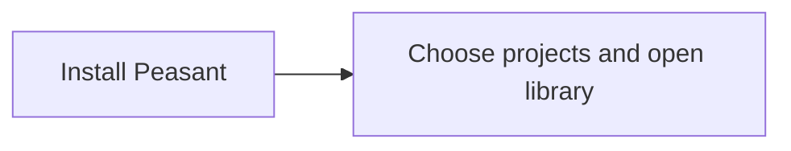

# Install Peasant, then open your library

**Proposal, not shipped behavior.** [Try the mockup](https://peasant-kickstart-proposal.handysoftwarestudios.chatgpt.site).

## Two decisions

1. **Install Peasant.** The website starts the appropriate platform download directly.
   Other platforms stay secondary. The user completes
   the normal operating-system installation and opens Peasant.
2. **Open library.** One local screen shows discovered projects. Choose projects,
   then select **open library** to save the selection, import locally, and enter
   the library. No welcome, separate import confirmation, or ready screen.

Existing configured installations open the library directly. Keep existing
selection and data. Keep other settings, including retention, unchanged unless
explicitly edited. There is no account, privacy questionnaire, or publishing step.

## Engineering boundary

Today, [`peasant kickstart`](../KICKSTART.md) requires an interactive terminal;
bare `peasant` does not run it, and the Claude plugin cannot install Peasant.
The download entry and local first-use screen above remain proposed.

Use verified [official artifacts](https://github.com/peasant-labs/peasant/releases),
confirm the target machine, OS/architecture, artifact/version, destination,
privileges, and effects before host approval. Reject failed verification and
unsupported platforms. Never run a generated installer or silently install on
a remote agent host.

Reuse Kickstart's canonical `ingest.SelectionMatcher`, validation, atomic save,
retention, and ingest engine. Require explicit project selection; existing
branch/session choices remain available without another mandatory screen.
Keep installation/save/import errors retryable. Never log in, install hooks,
or publish without the user's separate explicit action.
