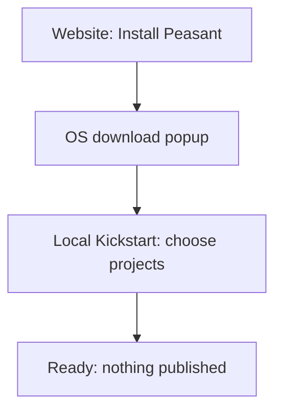

# Install Peasant and run Kickstart

**Proposal:** a simple website download popup followed by local setup. The popup,
native setup window, and agent installation handoff are new work, not shipped behavior.

[Rendered flow and interactive mockup](https://peasant-kickstart-proposal.handysoftwarestudios.chatgpt.site).

## What exists

Peasant has [official release artifacts](https://github.com/peasant-labs/peasant/releases)
and platform installation guides: [macOS](../install/macos.md),
[Linux](../install/ubuntu.md), [Windows](../install/windows.md), and
[Nix](../install/nix.md). Release archives/packages have published checksums.

Once installed, [`peasant kickstart`](../KICKSTART.md) discovers recordings,
lets the user choose projects, branches, and sessions, buffers settings for
review, then saves configuration, applies the chosen Claude retention setting,
and imports the selected recordings locally. It publishes nothing.

Kickstart currently needs an interactive terminal. Bare `peasant` does not start
it automatically, and running it through a noninteractive agent shell does not
complete setup. `peasant harvest` is an import command, not a headless wizard.

The existing Claude plugin requires `peasant` on `PATH`; it opens recordings or
configures separately requested auto-publication. It cannot bootstrap installation.

## Proposed flow

On the website, **Install Peasant** opens a small OS download popup. After
installation, project selection happens in the local Peasant app; a coding agent
can hand off to the same setup.

Bootstrap identifies the target machine, OS, and architecture; never silently
install on a remote agent host instead of the user's laptop. Before approval,
show the official artifact/version, destination, privileges, and effects. Use a
fixed installer or package-manager operation and published verification material.
Reject failed verification and unsupported platforms; never execute a
model-generated download command or arbitrary repository installer.

Use the existing interactive command when a terminal is available; otherwise
report that requirement and offer a handoff. A proposed native window must reuse
Kickstart's settings, selection matcher, validation, atomic save, retention,
and ingest engine.

Keep account connection optional. Never install hooks, log in, or publish
silently; an auto-publish preference installs no hook and publishes nothing.
Preserve existing data/settings: installation is not a reset. Report installation,
save, and import failures separately with retries.

Each provider needs a tested, explicit action and permission surface. Respect
host approvals, disabled hooks, and unavailable terminals; do not promise identical
installation in Claude Code, Codex, Cursor, OpenCode, or Gemini.

## Implementation boundary

Build the official bootstrap first, then the agent entry and terminal handoff;
add a native wizard only by adapting the existing engine. Validate fresh-machine
installation, existing installs, cancellation, verification failure, missing TTY,
and save/import retries with no unintended login, hooks, or publication.

Start with [release packaging](../../.goreleaser.yml),
[Kickstart wiring](../../cmd/peasant/cmd_kickstart_mount.go),
[terminal checks](../../cmd/peasant/terminal.go), and
[canonical settings](../../internal/tui/settings). Existing plugin code lives in
peasant-plugins under `plugins/peasant/{SKILL.md,scripts/open-session.sh}`.
